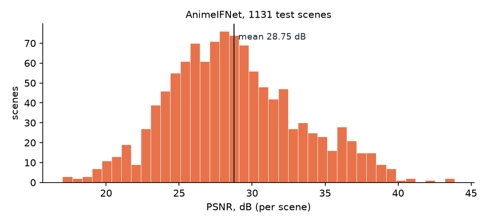

# AnimeIFNet — интерполяция промежуточных кадров для 2D-анимации

Нейросеть, которая по двум ключевым кадрам рисованной анимации генерирует промежуточный. Обычные модели интерполяции обучены на видео с реальной съёмкой и плохо справляются с аниме: плоскими заливками без текстуры, резкими контурами и крупными нелинейными движениями. В модели AnimeIFNet эти особенности учтены отдельно. Это дипломный проект (ВКР).

<!-- TODO: assets/demo.gif — кадр 1 | сгенерированный | кадр 3 -->

**Результат:** 28.75 dB PSNR / 0.942 SSIM на 1131 сцене тестового набора ATD-12K (подробности и оговорки — в разделе [Результаты](#результаты)).

## Подход

Архитектура основана на итеративной оценке потока в стиле IFNet ([RIFE](https://github.com/hzwer/ECCV2022-RIFE)). К ней добавлены входы и модули, учитывающие специфику рисованной анимации:

<p align="center">
  
</p>

<details>
<summary>Блок уточнения потока (FlowRefine)</summary>
<p align="center">
  
</p>
</details>

<details>
<summary>Уточняющая сеть (RefineNet) и ROI-композиция</summary>
<p align="center">
  
</p>
</details>

- **Оптический поток RAFT** — инициализация потока к моменту *t*. IFNet уточняет его за 5 итераций на 1/8 разрешения, затем дилатированным блоком на 1/4 и convex upsampling.
- **Контуры Anime2Sketch и distance transform до них.** Это доменный сигнал: в плоских заливках warping ненадёжен, и расстояние до ближайшей линии подсказывает модели, где нужна коррекция.
- **Segment-guided correlation.** Маска персонажа ISNet ослабляет сопоставление пикселей фона с пикселями персонажа в cost volume.
- **Трёхканальная окклюзия**: отдельно вес каждого warped-кадра и канал disocclusion для областей, которые нужно дорисовать.
- **Forward splatting** RGB и признаков ResNet-50 параллельно с backward warp: меньше «вытягивания из пустоты» при открывающихся областях.
- **RefineNet** (U-Net, channel + spatial self-attention в bottleneck) и **DTM** (идея из [EISAI](https://github.com/ShuhongChen/eisai-anime-interpolator)) дают итоговую поправку к coarse.
- **Подсказки художника**: скетч промежуточной позы и ROI-маска области, где модели разрешено уточнять кадр.
- *t* задаётся скаляром или попиксельной картой, поэтому разные части кадра могут двигаться с разным таймингом.

Модель — 14.8 M параметров, из них 14.5 M обучаемых. Энкодеры EfficientNet-B0 и ResNet-50 заморожены.

## Результаты

Оценка на **1131 сцене Disney-части тестового набора [ATD-12K](https://github.com/lisiyao21/AnimeInterp)** в исходном разрешении. Подмножество выбрано из-за ограниченных вычислительных ресурсов. Список сцен лежит в [`results/v8_2_disney1131/scenes.txt`](results/v8_2_disney1131/scenes.txt), метрики по каждой сцене — в [`metrics.csv`](results/v8_2_disney1131/metrics.csv).

| | PSNR, dB | SSIM |
|---|---|---|
| AnimeIFNet (без подсказок) | **28.75 ± 0.13** | **0.942** |

± — стандартная ошибка среднего по сценам. Смены сцены в выборке нет, NaN в выходах модели нет.



**Подсказки художника** (разница с базовым режимом на тех же сценах; скетч — контуры настоящего промежуточного кадра, ROI — маска персонажа):

| режим | ΔPSNR, dB | ΔSSIM | ΔPSNR вне ROI, dB |
|---|---|---|---|
| + скетч | −0.001 | −0.0001 | −0.03 |
| + ROI | +0.03 ± 0.01 | +0.005 | +1.06 |
| + скетч и ROI | +0.03 ± 0.01 | +0.005 | +1.06 |

Что из этого следует:
- **Скетч модель фактически игнорирует**, даже идеальный. Отдельного лосса, связывающего контуры результата со скетчем, при обучении не было, а через общий reconstruction-лосс модель использовать подсказку не научилась.
- **ROI работает как ограничитель, а не как улучшение.** Внутри маски качество не меняется, вне её берётся coarse-бленд. Для этого чекпоинта coarse на статичном фоне оказался на 1 dB лучше выхода RefineNet: уточняющая сеть слегка портит неподвижные области.

Ограничения оценки:
- В выборку не входит японская часть теста ATD-12K, которая обычно сложнее. Цифру нельзя напрямую сравнивать с результатами на полном тесте из статей.
- Прямого сравнения с RIFE / AnimeInterp на этих же сценах пока нет.

Воспроизведение: `python scripts/evaluate.py --data <ATD-12K test> --checkpoint <weights> --scene-list results/v8_2_disney1131/scenes.txt`.

## Структура

```
animeifnet/
  models/      blocks.py — строительные блоки; animeifnet.py — модель;
               animeifnet_v9_geom.py — экспериментальная ветка
  data/        датасеты ATD-12K и аугментации, согласованные с потоком
  losses.py    функции потерь
  training.py  цикл обучения с curriculum по подсказкам
  metrics.py   PSNR, SSIM, PSNR внутри/вне ROI
  pipeline.py  инференс: RAFT/ISNet/Anime2Sketch на лету, папки, метрики
app.py         Gradio-интерфейс с таймлайном ключевых кадров
scripts/       train.py, evaluate.py
tests/         pytest: модель, датасет, аугментации, обучение, оценка
results/       метрики из README
```

## Установка

```bash
pip install -r requirements.txt
```

Внешние модели:
- RAFT загружается из torchvision автоматически.
- [Anime2Sketch](https://github.com/Mukosame/Anime2Sketch) — репозиторий и веса указываются флагами `--a2s-repo` / `--a2s-weights`. Модель училась на контурах Anime2Sketch, без них используется DoG-фоллбэк и качество ниже.
- [IS-Net (DIS)](https://github.com/xuebinqin/DIS) — опционально, для маски персонажа: `--dis-repo` / `--isnet-weights`.

<!-- TODO: ссылка на веса AnimeIFNet (GitHub Releases / Hugging Face) -->

## Использование

**Интерфейс** — ключевые кадры, скетч, ROI, экспорт GIF/ZIP:

```bash
python app.py --checkpoint weights/animeifnet.pth --a2s-weights weights/anime2sketch.pth
```

**Папка кадров** — между соседними кадрами вставляются промежуточные:

```bash
python -m animeifnet.pipeline --input frames/ --output out/ \
    --checkpoint weights/animeifnet.pth --a2s-weights weights/anime2sketch.pth \
    --num-frames 3
```

Полезные флаги: `--tta`, `--easing ease_in_out`, `--roi seg`, `--sketch sketch.png`, `--fast` (быстрее примерно в 2 раза ценой до 1 dB PSNR).

**Обучение** — дообучение из чекпоинта V8 (без подсказок):

```bash
python scripts/train.py --data ATD-12K/train --save-dir checkpoints/v8_2 \
    --init-v8 checkpoints/v8/best.pth --epochs 40 --lr 5e-5
```

Любой гиперпараметр и вес лосса меняется флагом (`python scripts/train.py --help`). Подсказки вводятся постепенно: сначала обучение без них, затем скетч, затем ROI. Метрики по эпохам пишутся в `train_log.jsonl`.

**Данные.** Обучение и оценка используют заранее посчитанные признаки. Каждая сцена ATD-12K:

```
scene/
  frame1.png  frame2.png  frame3.png
  raft_fwd.npy  raft_bwd.npy           # RAFT 1→3 и 3→1, [2,H,W]
  seg0.npy  seg1.npy                   # маски ISNet, [1,H,W]
  a2s_edge0.npy  a2s_edge1.npy         # контуры Anime2Sketch
  a2s_dt0.npy  a2s_dt1.npy             # distance transform контуров
  a2s_gt.npy                           # контуры frame2 (скетч-подсказка), опционально
```

## Тесты

```bash
python -m pytest tests -q
```

Тесты проверяют формы выходов модели во всех режимах подсказок, эквивалентность пакетной генерации нескольких кадров покадровой, корректность аугментаций потока (после отражения или поворота поток по-прежнему объясняет движение), разбиение train/val без пересечений, короткое обучение с возобновлением и воспроизводимость оценки на подмножестве сцен.

## Дальнейшие шаги

- Отдельный лосс на совпадение контуров результата со скетчем, чтобы подсказка реально влияла на результат.
- Сравнение с RIFE и AnimeInterp на тех же сценах и оценка на полном тесте ATD-12K.
- Перенос скрипта подготовки признаков в `scripts/`.

## Благодарности

[ATD-12K / AnimeInterp](https://github.com/lisiyao21/AnimeInterp) · [RIFE](https://github.com/hzwer/ECCV2022-RIFE) · [RAFT](https://github.com/princeton-vl/RAFT) · [Anime2Sketch](https://github.com/Mukosame/Anime2Sketch) · [DIS / IS-Net](https://github.com/xuebinqin/DIS) · [Softmax Splatting](https://github.com/sniklaus/softmax-splatting) · [EISAI](https://github.com/ShuhongChen/eisai-anime-interpolator)
